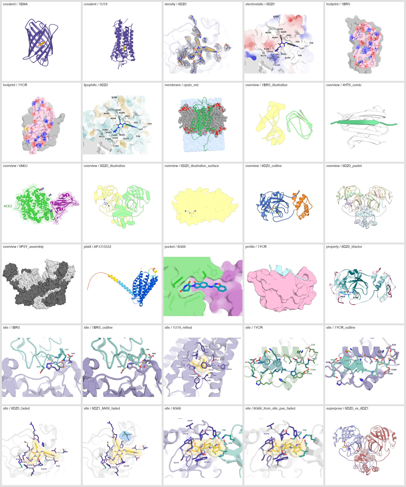
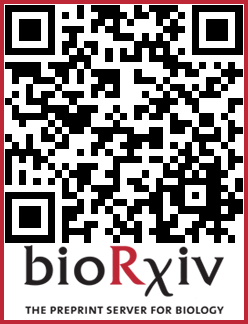

# PROTFIG

**Publication-ready molecular figures with one command.** PROTFIG runs PyMOL without a window and
turns a structure (PDB/mmCIF file, PDB code or PyMOL session) into a finished figure panel. You
choose a style (a *preset*), and PROTFIG detects the ligand or binding partner, picks the site
residues, finds hydrogen bonds, places the labels and orients the camera.



## Installation

You need PyMOL (open-source or commercial) with Python ≥ 3.11, NumPy, Pillow and Matplotlib.

```sh
git clone https://github.com/AmericaChi/PROTFIG.git
cd PROTFIG
conda env create -f environment.yml     # or, on macOS: brew install pymol
conda activate protfig
./protfig --list
```

Add the `PROTFIG` folder to your `PATH` to call `protfig` from anywhere.

## Quick start

```sh
protfig 8G66 --preset site --chains B,C,A                # ligand binding site (downloads 8G66)
protfig 1BRS --preset site --chains A,D                  # protein-protein interface
protfig my_protein.pdb --preset overview --style illustrative --bg transparent
protfig 1BRS --preset site --chains A,D --palette chimerax --save_preset mySite   # save options
protfig 2PTC --preset mySite                             # ...and reuse them
protfig --list                                           # all presets
protfig --help                                           # all options
```

Each figure gets its own folder, `figures/<preset>/<name>/`. Inside are the image (300 dpi PNG by
default; TIFF, JPG and PDF also available), the PyMOL session for fine-tuning by hand, the labels
as editable SVG, and text files listing the site residues and hydrogen bonds. Add `--draft` for a
quick preview.

## Presets

13 presets with 19 styles, in three groups. Choose a preset with `--preset` and a style with
`--style`; any preset that colors by chain also takes a palette (`--palette lavender`, `nordic`,
`sage`, `candy`, `vivid`...).

**Local: the binding site or interface, close up**

| Preset | Styles | Shows |
|---|---|---|
| `site` | default, `faded`, `outline` | Site residues, hydrogen bonds and labels on both sides. `faded`: gray protein, colored sticks; `outline`: pastel with a black outline. Detects covalent partners (retinal–Lys, drug–Cys, GFP chromophore) |
| `pocket` | | The ligand or peptide lying in its surface groove |
| `footprint` | | Footprint of the partner on the receptor surface |
| `density` | | Site with the electron-density mesh (`--map`) |

**Global: the whole molecule**

| Preset | Styles | Shows |
|---|---|---|
| `overview` | default, `outline`, `comic`, `illustrative`, `pastel`, `assembly` | Cartoon + translucent surface per chain; outlined cartoon with a highlighted region; white cartoon with the partner in front; flat illustration; N→C gradient; oligomer surface seen from the side |
| `profile` | | Side view: receptor surface with the peptide or protein partner on top |
| `superpose` | | Two superposed structures, with the RMSD (`--ref`) |
| `membrane` | | Membrane protein in its lipid bilayer (MD frame), with its water (`--waters`) |
| `covalent` | | Whole protein with a group bound to it or built into it (GFP chromophore, retinal) |

**Colored by a property**

| Preset | Shows |
|---|---|
| `electrostatic` | Surface colored by electrostatic potential |
| `lipophilic` | Surface colored by lipophilicity |
| `property` | Cartoon colored by B-factor or your own per-residue values |
| `plddt` | AlphaFold model colored by confidence (pLDDT), AlphaFold Database colors |

Mutations (`--mutation`) can be highlighted in any preset. There is a thumbnail of every preset and
style in [`docs/presets/`](docs/presets). Names used by earlier versions (`site_faded`,
`interface_closeup`, `binding_surface`, `outline`, `illustrative`, `pastel`, `oligomer`) still work.

## Benchmark

[`benchmark/`](benchmark) runs every preset on PDB entries used nowhere else in PROTFIG and reports
failures and the time per figure ([`benchmark/results/summary.csv`](benchmark/results/summary.csv)).
See [`benchmark/README.md`](benchmark/README.md) to reproduce it.

## Documentation

The **[manual](MANUAL.md)** explains how the binding partner is chosen, every option (colors,
labels, camera, image), how to adjust a figure in PyMOL and render it again, how to make many
figures from one `.toml` file, and the method's limitations.

## Reproducing the paper figures

[`paper_figures/`](paper_figures) contains the panels of the PROTFIG article and the
`figures.toml` that generates them. All inputs are public structures.

```sh
cd paper_figures
./get_inputs.sh && ../protfig --config figures.toml --jobs 8
```

## Contributing and feedback

Contributions from the community are welcome: fork the repository, make your changes and open a
pull request. For questions, bug reports or suggestions, write to chiamerika@hotmail.com or reach
out on Discord (`alluring_hamster_56289`).

## Citation

If PROTFIG is useful in your work, please cite:

> L. America Chi. PROTFIG: one-command, publication-quality biomolecular figures. bioRxiv (2026).
> https://doi.org/10.64898/2026.10.20.760606

<a href="https://doi.org/10.64898/2026.10.20.760606"></a>

## License

MIT. See [LICENSE](LICENSE).
