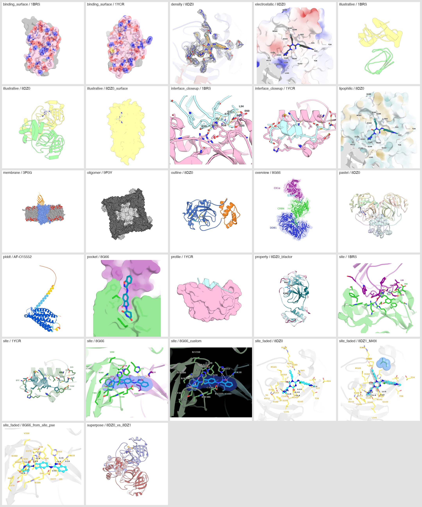
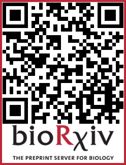

# PROTFIG

**Publication-ready molecular figures with one command.** PROTFIG runs PyMOL without a window and
turns a structure (PDB/mmCIF file, PDB code or PyMOL session) into a finished figure panel. You
choose a style (a *preset*), and PROTFIG detects the ligand or binding partner, picks the site
residues, finds hydrogen bonds, places the labels and orients the camera.



## Installation

You need PyMOL (open-source or commercial) with Python ≥ 3.11, NumPy, Pillow and Matplotlib.

```sh
git clone https://github.com/AmericaChi/PROTFIG.git
cd PROTFIG
conda env create -f environment.yml     # or, on macOS: brew install pymol
conda activate protfig
./protfig --list
```

Add the `PROTFIG` folder to your `PATH` to call `protfig` from anywhere.

## Quick start

```sh
protfig 8G66 --preset site --chains B,C,A                # ligand binding site (downloads 8G66)
protfig 1BRS --preset interface_closeup --chains A,D     # protein-protein interface
protfig my_protein.pdb --preset illustrative --bg transparent
protfig --list                                           # all presets
protfig --help                                           # all options
```

Each figure gets its own folder, `figures/<preset>/<name>/`. Inside are the image (300 dpi PNG by
default; TIFF, JPG and PDF also available), the PyMOL session for fine-tuning by hand, the labels
as editable SVG, and text files listing the site residues and hydrogen bonds. Add `--draft` for a
quick preview.

## Presets

| Preset | Shows |
|---|---|
| `site` | Binding site: residues, hydrogen bonds and labels |
| `site_faded` | Site with distances in Å; mutations and a reference ligand |
| `pocket` | The ligand or peptide lying in its surface groove |
| `interface_closeup` | Close-up of a protein-protein or peptide interface |
| `binding_surface` | Binding footprint on the receptor surface |
| `profile` | Side view: receptor surface with the peptide or protein partner on top |
| `density` | Site with the electron-density mesh |
| `overview` | Whole complex, colored by chain |
| `outline` | Cartoon with outline, highlighted region and key residues |
| `illustrative` | Flat illustration style (cartoon or surface) |
| `pastel` | Pastel cartoon with an N→C gradient |
| `oligomer` | Assembly as a surface, one shade per chain |
| `membrane` | Membrane protein inside its lipid bilayer |
| `electrostatic` | Surface colored by electrostatic potential |
| `lipophilic` | Surface colored by lipophilicity |
| `property` | Cartoon colored by B-factor or your own per-residue values |
| `plddt` | AlphaFold model colored by confidence (pLDDT), AlphaFold Database colors |
| `superpose` | Two superposed structures, with RMSD |

There is a thumbnail of every preset in [`docs/presets/`](docs/presets).

## Documentation

The **[manual](MANUAL.md)** explains how the binding partner is chosen, every option (colors,
labels, camera, image), how to adjust a figure in PyMOL and render it again, how to make many
figures from one `.toml` file, and the method's limitations.

## Reproducing the paper figures

[`paper_figures/`](paper_figures) contains the panels of the PROTFIG article and the
`figures.toml` that generates them. All inputs are public structures.

```sh
cd paper_figures
./get_inputs.sh && ../protfig --config figures.toml --jobs 8
```

## Contributing and feedback

Contributions from the community are welcome: fork the repository, make your changes and open a
pull request. For questions, bug reports or suggestions, write to chiamerika@hotmail.com or reach
out on Discord (`alluring_hamster_56289`).

## Citation

If PROTFIG is useful in your work, please cite:

> L. America Chi. PROTFIG: one-command, publication-quality biomolecular figures. bioRxiv (2026).
> https://doi.org/10.64898/2026.10.20.760606

<a href="https://doi.org/10.64898/2026.10.20.760606"></a>

## License

MIT. See [LICENSE](LICENSE).
